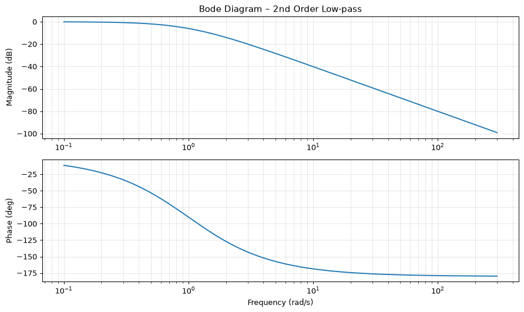

**English** | [Deutsch](README.de.md)

# 📈 Function Plotter 🚀

A versatile plotting tool built with **Python**, **Tkinter** and **Matplotlib**. From simple 2D curves and
parametric shapes to Bode diagrams and 3D surfaces, it turns mathematical expressions into clear, interactive plots
– with automatic curve analysis and support for measured data.

👥 Team project by **Firas Mannai** and **[Yahia Bannour](https://github.com/yahiabannour)**.

| 📉 Functions, curve analysis and measured data | 📶 Bode diagram | 🏔️ 3D surface and contour lines |
|---|---|---|
|  |  |  |

---

## ✨ Features

### 🖼️ Four Plot Modes
* **2D Plotting**: Draw several functions at once, each with its own colour, line width and line style.
* **🌀 Parametric Curves**: Plot curves defined by x(t) and y(t).
* **📶 Bode Diagrams**: Show magnitude and phase of a transfer function from its numerator and denominator
  coefficients.
* **🏔️ 3D Surfaces & Contours**: Display functions f(x, y) as a surface and as a contour map side by side.

---

### 🔬 Curve Analysis
* **Automatic Markers**: Find and mark **roots**, **extrema** and **inflection points** – roots are refined by
  linear interpolation.
* **Derivatives**: Overlay the numerical **1st and 2nd derivative** of every function.

---

### 📊 Data & Configuration
* **Measured Data**: Load x/y values from a `.txt` or `.csv` file and compare them with the functions, as a line or
  scatter plot.
* **💾 Save & Load**: Store all settings in a readable configuration file and restore them later.

---

### 🖱️ Interactive & Safe
* **Interactive GUI**: Live cursor coordinates, click-to-annotate points, zoom and pan, and export as an image.
* **Headless Mode**: Generate a plot directly from a configuration file, without opening the GUI.
* **🔒 Safe Evaluation**: Expressions can only use a whitelist of maths functions – no access to Python built-ins.

---

## 🚀 Getting Started

### 📋 Prerequisites

Python 3 with NumPy and Matplotlib:

```bash
pip install numpy matplotlib
```

### 🏃 Running the App

1. **GUI Mode** (default):
   ```bash
   python app.py
   ```
   Opens the interactive window with all settings.

2. **Headless Mode**:
   ```bash
   python app.py config_bode.txt
   ```
   Opens the plot for the given configuration file directly.

---

## 🛠️ Configuration File Format

Configuration files use a simple `key: value` format:

```text
# Two functions with curve analysis and measured data
functions: [exp(-0.5*x)*sin(x), cos(x)]
xstart: 0
xend: 10
xstep: 0.1
find_roots: True
find_extrema: True
data_file: messwerte.txt
title: Function Plot Example
```

More examples: [`config_bode.txt`](config_bode.txt), [`config_3d.txt`](config_3d.txt) and [`saved_config.txt`](saved_config.txt).

---

## 📂 Project Structure

* `app.py`: Entry point – starts the GUI, or headless mode when a configuration file is given.
* `gui.py`: The Tkinter interface with controls for every mode and the embedded Matplotlib canvas.
* `plotter.py`: All plotting and the numerical analysis, independent of the GUI.
* `config_parser.py`: Reads configuration files and converts the values to booleans, numbers and lists.
* `widgets.py`: A scrollable frame for the long control panel.
* `config_bode.txt`, `config_3d.txt`, `saved_config.txt`, `messwerte.txt`: Example configurations and measured data.

---

## 🧩 Supported Math Functions

Use standard math notation in the input fields:

* `sin`, `cos`, `tan`, `exp`, `log`, `log10`, `sqrt`, `abs`
* Constants: `pi`, `e`
* Power operator: `^` (e.g. `x^2`)
